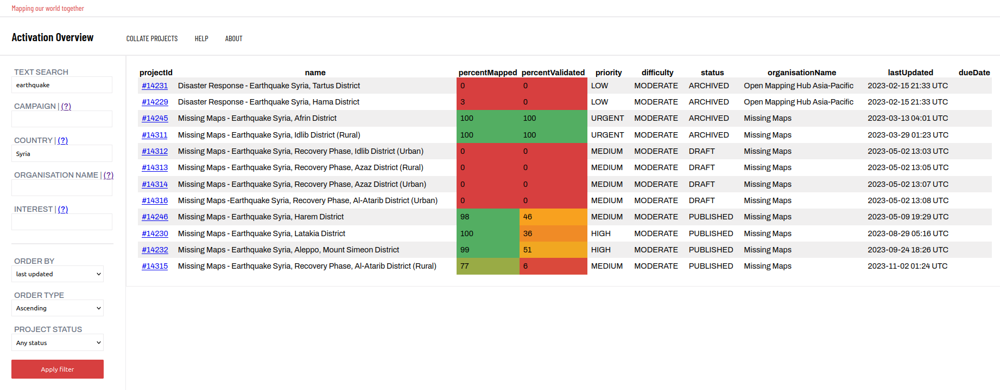

# What is HOTOSM Collate?

HOTOSM Collate is primarily intended to help HOTOSM activation managers to keep track of the progress of Tasking Manager mapping projects during an activation by gathering their status information in a table format without much effort. It also has uses for project gardening: finding old inactive or completed projects that are still hanging around without having been archived.

For example, at the time of writing, a table of all Tasking Manager project mentioning "earthquake" that are located in Syria looks like this: 

Collate is a seperate piece of software to the HOTOSM Tasking Manager, however it uses the same project data as main Tasking Manager instance tasks.hotosm.org. The data is pulled in in real-time from the Tasking manager API. Therefore if you project is on tasks.hotosm.org, it will also show up in this tool. 

# Questions and Bug reports 

If you have any questions or requests about this tool, please feel free to contact me at @jarmokivekas on the HOTOSM slack workspace. I'm happy to help or hear out any 

You can also create an issue in the [github repository](https://github.com/jarmokivekas/hotosm-collate/issues)

The intended use of this tool is to help HOTOSM activation managers to keep track of progress in ongoing projects in an activation.

# Maintainers

So far this is a solo developer project and I (Jarmo) am it's only maintainer. It's just a side project I work on every now and then when I feel like it (or something breaks :))

Issues or pull requests on github are welcome, and if the HOTOSM tech team at some point wants to take this project under their own care, that is also possible. In fact it would probably make sense considering how tied this is to the tasking manager and HOTOSM activites in general. The software is licensed under the BSD 2-Clause License which allows redistribution of modified copies.